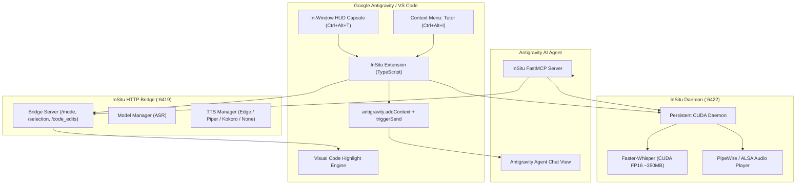

# <div align="center"><br/>InSitu: In-Editor Voice & Socratic AI Mentor</div>

<div align="center">

[](https://github.com/Brilliafy/insitu/releases)
[](LICENSE)
[](https://antigravity.google)
[](https://developer.nvidia.com/cuda-zone)
[](https://huggingface.co)

**A high-performance in-window voice overlay, low-latency STT/TTS engine, and Dual-Channel Socratic mentor custom-built for Google Antigravity and VS Code.**

[Features](#-key-features) • [Antigravity Customization](#-tailored-for-google-antigravity) • [Installation](#-installation) • [Keyboard Shortcuts](#-keyboard-shortcuts) • [Architecture](#-architecture) • [Model Tiers](#-model-tier-guide) • [License](#-license)

</div>

---

## 💡 What is InSitu?

**InSitu** transforms your coding environment into an interactive, voice-driven pair-programming studio. Instead of constantly context-switching between detached chat interfaces and editor tabs, InSitu integrates directly into the active editor viewport:

1. **Dual-Channel Socratic Protocol:** The AI agent provides deep technical reasoning, code structures, and diagrams in chat, while concurrently speaking a concise, natural, 1–2 sentence human voice companion out loud via the `speak_to_user` tool.
2. **Custom-Tailored for Google Antigravity:** Direct native IPC hookups into Antigravity’s native Agent Panel (`antigravity.panel.focus`, `antigravity.addContext`, and `antigravity.triggerSend`), pairing seamlessly with FastMCP tools.
3. **Mandatory In-File Code Replacement (Mode 1):** When asking for alternative implementations or scaffolding, the AI doesn't just print code in chat—it directly updates and replaces the highlighted lines inside the active file buffer.
4. **Toggable Read-Only Mode:** Need to ask *"Are there any caveats with this mp.pool?"* without having the AI rewrite your code? Toggle **AI File Modifications: DISABLED** to force the agent into read-only analytical mode.
5. **Multi-Engine Voice Catalog & Silent Mode ("None"):**
   - **Edge Neural TTS (Free, Studio Human Quality):** 26 curated neural voices across American, British, Australian, Canadian, Irish, and Indian English accents.
   - **Piper ONNX:** Ultra-fast offline voices (<150ms latency).
   - **Kokoro-82M ONNX:** 54 expressive voices across US, UK, Japanese, and Mandarin.
   - **None (Silent Mode):** Completely mutes all spoken audio and causes the MCP voice tool to silently succeed without playback.
6. **Prewarmed CUDA Daemon (`:6422`):** Holds Faster-Whisper in GPU VRAM (~350 MB on GTX 1050+) for near-instant transcription with custom coding vocabulary bias (`snake_case`, `kubectl`, `async/await`).
7. **Topmost Floating HUD (`Ctrl+Alt+T`):** A clean in-window overlay to dictate prompts, switch modes, change voices, or toggle CUDA on the fly.

---

## ⚡ Tailored for Google Antigravity

InSitu v1.0.0 is specifically customized for the **Google Antigravity IDE**:

- **Native Chat Context Injection:** Bypasses clipboard race conditions by sending prompts directly via `antigravity.addContext` and triggering agent evaluation via `antigravity.triggerSend`.
- **Integrated FastMCP Server (`server/tutor_mcp.py`):** Grants Antigravity AI agents direct programmatic access to:
  - `speak_to_user(message)`: Immediate voice feedback without terminal lag.
  - `stop_speech()`: Instantly cuts off currently playing speech.
  - `get_tutor_mode()` & `set_tutor_mode(mode)`: Socratic mode management.
  - `get_active_editor_selection()`: High-fidelity inspection of the user's active file, line range, and selected code.
  - `get_code_edits_mode()` & `set_code_edits_mode(allow)`: Enforces whether the agent may edit files or remain in read-only explanation mode.
  - `highlight_and_navigate(file, startLine, endLine)`: Visually guides the user's viewport to the exact code under discussion.
  - `clear_highlight()`: Clears the focus box from the editor.

---

## 🚀 Key Features

<table>
  <tr>
    <td width="50%">
      <h3>🎙️ Voice Dictation with Coding Vocabulary</h3>
      <ul>
        <li>Hands-free prompt dictation using <code>Ctrl+Alt+M</code>.</li>
        <li>Automatic voice activity detection (VAD) stops after 2s silence.</li>
        <li>Vocabulary biasing tunes the ASR engine to understand programming syntax.</li>
      </ul>
    </td>
    <td width="50%">
      <h3>🔊 Dual-Channel Audio & Silent Mode</h3>
      <ul>
        <li>Reads concise mentor guidance out loud using Edge Neural, Piper, or Kokoro.</li>
        <li>Select from 26 regional English accents (US, UK, AU, CA, IE, IN).</li>
        <li>Select <b>None</b> to disable TTS entirely for silent, text-only pair-programming.</li>
      </ul>
    </td>
  </tr>
  <tr>
    <td width="50%">
      <h3>⚡ CUDA Hardware Acceleration</h3>
      <ul>
        <li>Toggle between CPU (INT8) and GPU (CUDA Float16) instantly with <code>Ctrl+Alt+G</code>.</li>
        <li>Prewarmed daemon keeps Faster-Whisper ready in ~350 MB VRAM.</li>
      </ul>
    </td>
    <td width="50%">
      <h3>🎯 3 Socratic Teaching Modes</h3>
      <ul>
        <li><b>Mode 1 (Section Scaffold):</b> High-level skeletons with direct file replacement.</li>
        <li><b>Mode 2 (Line-by-Line Step):</b> Micro-step pedagogical guidance, single line at a time.</li>
        <li><b>Mode 3 (Refactor / Doubt):</b> Deep dive into selected blocks and trade-offs.</li>
      </ul>
    </td>
  </tr>
  <tr>
    <td width="50%">
      <h3>🔒 AI File Modification Toggle</h3>
      <ul>
        <li><b>ENABLED:</b> AI directly updates the code in your active files.</li>
        <li><b>DISABLED (Read-Only):</b> Ask exploratory questions and caveats without risking unintended code edits.</li>
      </ul>
    </td>
    <td width="50%">
      <h3>🖌️ In-Editor Navigation & Highlighting</h3>
      <ul>
        <li>Visual highlighting of code ranges with a soft cyan focus bar.</li>
        <li>Context-menu <b>Tutor</b> action sends selected lines straight to the AI.</li>
        <li>One-click clearing via editor title bar or <code>Ctrl+Alt+C</code>.</li>
      </ul>
    </td>
  </tr>
</table>

---

## 🏗️ Architecture



---

## ⌨️ Keyboard Shortcuts

| Shortcut | Description | Context / Scope |
| :--- | :--- | :--- |
| <kbd>Ctrl</kbd> + <kbd>Alt</kbd> + <kbd>T</kbd> | **Open InSitu In-Window HUD Overlay** | Global Editor |
| <kbd>Ctrl</kbd> + <kbd>Alt</kbd> + <kbd>M</kbd> | **Toggle Voice Dictation (Speak)** | Global Editor |
| <kbd>Alt</kbd> + <kbd>S</kbd> / <kbd>Ctrl</kbd> + <kbd>Alt</kbd> + <kbd>S</kbd> | **Instant Stop & Silence Speech** | Global Editor |
| <kbd>Ctrl</kbd> + <kbd>Alt</kbd> + <kbd>G</kbd> | **Toggle Hardware Acceleration (CPU / GPU CUDA)** | Global Editor |
| <kbd>Ctrl</kbd> + <kbd>Alt</kbd> + <kbd>V</kbd> | **Select Preset Voice (Edge Neural / Kokoro / Piper)** | Global Editor |
| <kbd>Ctrl</kbd> + <kbd>Alt</kbd> + <kbd>O</kbd> | **Select or Download STT/TTS Model** | Global Editor |
| <kbd>Ctrl</kbd> + <kbd>Alt</kbd> + <kbd>I</kbd> | **Send Selection to AI Mentor ("Tutor")** | Text Editor Selection |
| <kbd>Ctrl</kbd> + <kbd>Alt</kbd> + <kbd>C</kbd> | **Clear Visual Code Highlight** | When Highlight Active |

---

## 📦 Model Tier Guide

### Speech-to-Text (ASR) Models

| Tier | Model Identifier | Parameters / Disk | RAM / VRAM | Recommended Hardware |
| :--- | :--- | :--- | :--- | :--- |
| **Tier 1: Edge** | `UsefulSensors/moonshine-tiny` | 27M (~50 MB) | < 100 MB RAM | Ultra-low-spec laptops, Raspberry Pi. |
| **Tier 1: Edge** | `Systran/faster-whisper-tiny.en` | 39M (~72 MB) | ~150 MB RAM | Standard baseline CPU dictation. |
| **Tier 2: 1 GB** | `Systran/faster-distil-whisper-small.en` | 166M (~316 MB) | **~350 MB VRAM** | **Default & Sweet Spot.** Prewarmed in CUDA on GTX 1050+. |
| **Tier 2: 1 GB** | `Systran/faster-distil-whisper-medium.en` | 394M (~752 MB) | ~1.0 GB VRAM | High-accuracy technical transcription. |
| **Tier 3: 2 GB** | `deepdml/faster-whisper-large-v3-turbo-ct2` | 809M (~1.5 GB) | ~1.8 GB VRAM | Near Large-v3 accuracy at 6x speed. |
| **Tier 4: 3 GB** | `Systran/faster-whisper-large-v3` | 1.55B (~2.9 GB) | ~3.0 GB VRAM | Maximum accuracy for complex multi-language tasks. |

### Text-to-Speech (TTS) Models

| Engine | Engine ID | Voices Catalog | Key Advantage |
| :--- | :--- | :--- | :--- |
| **None** | `none` | **Muted (Silent)** | Completely silences all voice output. `speak_to_user` silently succeeds. |
| **Edge Neural** | `microsoft/edge-tts` | **26 Regional Voices** | Studio human quality (US, UK, AU, CA, IE, IN). 0 MB VRAM / CPU overhead. |
| **Kokoro-82M** | `hexgrad/Kokoro-82M` | **54 Voices (US/UK/JA/ZH)** | Gold-standard expressive local speech. |
| **Piper ONNX** | `rhasspy/piper-voices` | **6 Voices (Bryce, Ryan, Lessac)** | Offline, sub-150ms instant start. |
| **F5-TTS** | `SWivid/F5-TTS` | **Zero-Shot Voice Cloning** | Clone any speaker from a 3–10s WAV clip. |

---

## 🛠️ Installation & Setup

### 1-Click Automated Installation

Clone this repository and run the setup script:

```bash
git clone https://github.com/Brilliafy/insitu.git
cd insitu
chmod +x install.sh
./install.sh
```

The script automatically:
1. Detects or creates the Python environment (`socratic-tutor`).
2. Installs required audio, ONNX, and MCP libraries.
3. Compiles the TypeScript extension and packages `insitu-1.0.0.vsix`.
4. Installs `insitu-1.0.0.vsix` into VS Code / Google Antigravity.
5. Injects the **Dual-Channel Socratic Protocol** into `~/.gemini/GEMINI.md`.

### Manual FastMCP Server Setup

If configuring Antigravity's MCP configuration manually, add InSitu to your MCP settings:

```json
{
  "mcpServers": {
    "insitu": {
      "command": "/home/Aelfwif/anaconda3/envs/socratic-tutor/bin/python",
      "args": ["/home/Aelfwif/insitu/server/tutor_mcp.py"]
    }
  }
}
```

---

## 📄 License

Distributed under the [MIT License](LICENSE). Copyright © 2026 Brilliafy.
