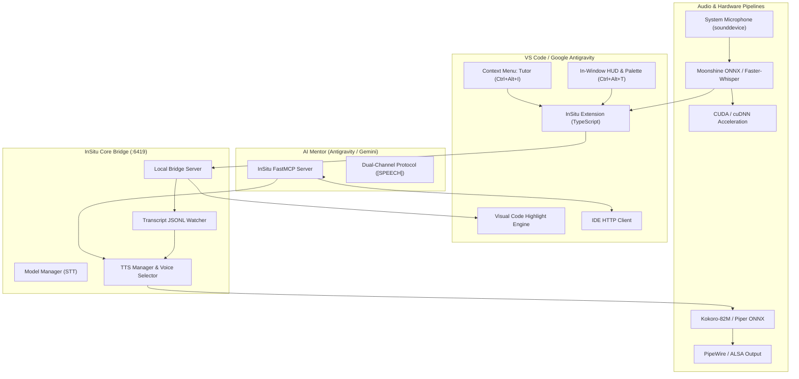

# <div align="center"> InSitu: In-Editor Voice & Socratic AI Mentor</div>

<div align="center">

[](https://github.com/Brilliafy/insitu/releases)
[](LICENSE)
[](https://marketplace.visualstudio.com)
[](https://developer.nvidia.com/cuda-zone)
[](https://huggingface.co)

**A high-performance in-window voice overlay, low-latency STT/TTS engine, and Dual-Channel Socratic mentor for VS Code and Google Antigravity IDE.**

[Features](#-key-features) • [Installation](#-installation) • [Keyboard Shortcuts](#-keyboard-shortcuts) • [Architecture](#-architecture) • [Model Tiers](#-model-tier-guide) • [License](#-license)

</div>

---

## 💡 What is InSitu?

**InSitu** transforms your coding environment into an interactive pair-programming studio. Instead of constantly context-switching between chat windows and code files, InSitu integrates directly into the editor viewport:

1. **Dual-Channel Socratic Protocol:** The AI provides full, detailed code and explanations in the chat window, while concurrently speaking a concise, natural, 1-2 sentence human voice companion (`speak_to_user` or `[SPEECH] ... [/SPEECH]`).
2. **Topmost In-Window HUD Overlay:** A frameless, lightning-fast floating capsule HUD (`Ctrl+Alt+T`) right on top of your editor. Dictate prompts, switch modes, or clear highlights without touching the mouse.
3. **Local Speech-to-Text (STT) with Coding Bias:** Powered by Moonshine ONNX and Faster-Whisper (CTranslate2). Biased for programming terms like `snake_case`, `kubectl`, `async/await`, and syntax tokens.
4. **Local Text-to-Speech (TTS):** Instant audio generation via Kokoro-82M (54 voices: American, British, Japanese) and Piper ONNX with sub-50ms latency.
5. **One-Click GPU Acceleration:** Dynamically toggle between CPU (INT8 quantized) and GPU (CUDA Float16) directly from the command palette.
6. **Reclaim Disk Space:** Easily view on-disk cache sizes and purge downloaded model weights with single-click model deletion.

---

## 🚀 Key Features

<table>
  <tr>
    <td width="50%">
      <h3>🎙️ Voice Dictation with Coding Vocabulary</h3>
      <ul>
        <li>Hands-free prompt dictation using <code>Ctrl+Alt+M</code>.</li>
        <li>Automatic voice activity detection (VAD) stops after 2s silence.</li>
        <li>Customizable vocabulary prefix biases the model to technical terms.</li>
      </ul>
    </td>
    <td width="50%">
      <h3>🔊 Natural Dual-Channel Audio</h3>
      <ul>
        <li>Reads AI mentor suggestions out loud using ultra-light local models.</li>
        <li>Deduplication engine prevents audio echoes or re-speaking history.</li>
        <li>Instant silence button with <code>Alt+S</code> or <code>Ctrl+Alt+S</code>.</li>
      </ul>
    </td>
  </tr>
  <tr>
    <td width="50%">
      <h3>⚡ Instant CPU / GPU CUDA Toggling</h3>
      <ul>
        <li>Switch between CPU and GPU inference on the fly (<code>Ctrl+Alt+G</code>).</li>
        <li>Supports 1GB, 2GB, and 3GB models tailored for modern GPUs (GTX 1050 to RTX 4090).</li>
      </ul>
    </td>
    <td width="50%">
      <h3>🎯 3 Socratic Teaching Modes</h3>
      <ul>
        <li><b>Mode 1 (Section Scaffold):</b> High-level architectural skeletons.</li>
        <li><b>Mode 2 (Line-by-Line Step):</b> Micro-step pedagogical guidance.</li>
        <li><b>Mode 3 (Refactor / Doubt):</b> Deep dive into selected code blocks.</li>
      </ul>
    </td>
  </tr>
  <tr>
    <td width="50%">
      <h3>🧹 Disk Space Reclaim</h3>
      <ul>
        <li>View accurate on-disk size (e.g. <code>316 MB</code>, <code>1.45 GB</code>) for every model.</li>
        <li>Purge unused model weights directly from the QuickPick palette.</li>
      </ul>
    </td>
    <td width="50%">
      <h3>🖌️ In-Editor Navigation & Highlighting</h3>
      <ul>
        <li>Visual highlighting of code ranges with a soft cyan focus bar.</li>
        <li>Context-menu <b>Tutor</b> action sends selected lines straight to the AI.</li>
        <li>One-click clearing via editor title bar or <code>Ctrl+Alt+C</code>.</li>
      </ul>
    </td>
  </tr>
</table>

---

## 🏗️ Architecture



---

## ⌨️ Keyboard Shortcuts

| Shortcut | Description | Context / Scope |
| :--- | :--- | :--- |
| <kbd>Ctrl</kbd> + <kbd>Alt</kbd> + <kbd>T</kbd> | **Open InSitu In-Window HUD Overlay** | Global Editor |
| <kbd>Ctrl</kbd> + <kbd>Alt</kbd> + <kbd>M</kbd> | **Toggle Voice Dictation (Speak)** | Global Editor |
| <kbd>Alt</kbd> + <kbd>S</kbd> / <kbd>Ctrl</kbd> + <kbd>Alt</kbd> + <kbd>S</kbd> | **Instant Stop & Silence Speech** | Global Editor |
| <kbd>Ctrl</kbd> + <kbd>Alt</kbd> + <kbd>G</kbd> | **Toggle Hardware Acceleration (CPU / GPU CUDA)** | Global Editor |
| <kbd>Ctrl</kbd> + <kbd>Alt</kbd> + <kbd>V</kbd> | **Select Preset Voice (54 Kokoro / Piper Voices)** | Global Editor |
| <kbd>Ctrl</kbd> + <kbd>Alt</kbd> + <kbd>O</kbd> | **Select or Download STT/TTS Model** | Global Editor |
| <kbd>Ctrl</kbd> + <kbd>Alt</kbd> + <kbd>I</kbd> | **Send Selection to AI Mentor ("Tutor")** | Text Editor Selection |
| <kbd>Ctrl</kbd> + <kbd>Alt</kbd> + <kbd>C</kbd> | **Clear Visual Code Highlight** | When Highlight Active |

---

## 📦 Model Tier Guide

### Speech-to-Text (ASR) Models

| Tier | Hugging Face ID | Size / Params | RAM / VRAM | Best Suited For |
| :--- | :--- | :--- | :--- | :--- |
| **Tier 1: Edge** | `UsefulSensors/moonshine-tiny` | 50 MB / 27M | < 100 MB RAM | **Weak CPUs / Laptops.** Near-zero RAM, sub-50ms latency. |
| **Tier 1: Edge** | `Systran/faster-whisper-tiny.en` | 72 MB / 39M | ~150 MB RAM | Fast baseline Whisper with programming prompt bias. |
| **Tier 2: 1 GB** | `Systran/faster-distil-whisper-small.en` | 316 MB / 166M | ~500 MB RAM | **Sweet Spot for Coding.** 6x faster Whisper, high jargon accuracy. |
| **Tier 2: 1 GB** | `Systran/faster-distil-whisper-medium.en` | 752 MB / 394M | ~1.0 GB RAM | True 1 GB model with Medium model accuracy at 4x speed. |
| **Tier 3: 2 GB** | `deepdml/faster-whisper-large-v3-turbo-ct2` | 1.5 GB / 809M | ~1.8 GB VRAM | **Top recommendation for 2 GB GPUs.** Large-v3 quality at 6x speed. |
| **Tier 3: 2 GB** | `Systran/faster-distil-whisper-large-v3` | 1.4 GB / 756M | ~2.0 GB VRAM | State-of-the-art English transcription, highly compressed. |
| **Tier 4: 3 GB** | `Systran/faster-whisper-large-v3` | 2.9 GB / 1.55B | ~3.0 GB VRAM | Benchmark maximum accuracy for complex multilingual coding tasks. |

### Text-to-Speech (TTS) Models

| Model ID | Engine | Voices | Key Advantage |
| :--- | :--- | :--- | :--- |
| `hexgrad/Kokoro-82M` | StyleTTS2 / ONNX | **54 High-Quality Presets** | Near-commercial naturalness, crisp cadence on pure CPU or GPU. |
| `rhasspy/piper-voices` | VITS / ONNX | **100+ Standalone Voices** | Sub-20ms instant start, lightweight memory footprint (<50 MB). |
| `SWivid/F5-TTS` | Flow Matching | **Zero-Shot Voice Cloning** | Clone any speaker from a 3–10s WAV clip with flawless intonation. |

---

## 🛠️ Installation & Setup

### Automated 1-Click Install

Clone this repository and run the installer:

```bash
git clone https://github.com/Brilliafy/insitu.git
cd insitu
chmod +x install.sh
./install.sh
```

The script automatically:
1. Detects or installs Python dependencies (`fastmcp`, `sounddevice`, `kokoro`, `faster-whisper`, `pyqt6`).
2. Compiles and installs the `insitu-0.3.0.vsix` extension into VS Code / Antigravity.
3. Appends the **Dual-Channel Socratic Protocol** to `~/.gemini/GEMINI.md` (if not already present).
4. Configures the InSitu FastMCP server in your MCP settings.

### Manual MCP Server Configuration

Add InSitu to your `mcp_config.json`:

```json
{
  "mcpServers": {
    "insitu": {
      "command": "/path/to/python",
      "args": ["/path/to/insitu/server/tutor_mcp.py"]
    }
  }
}
```

---

## 📄 License

This project is licensed under the [MIT License](LICENSE).
